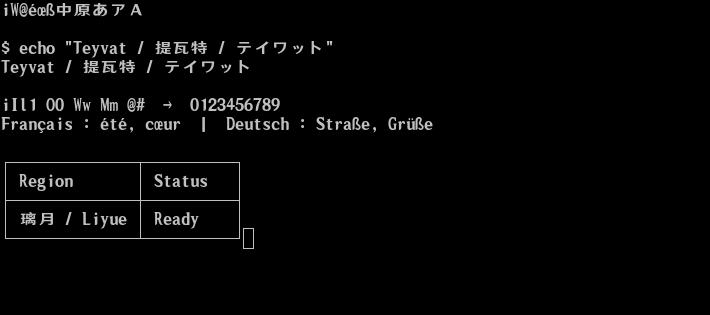

# Genshin Terminal Mono

把原神风格的 HYWenHei 字形调整成适合终端的双宽字体。英文、数字和常用法语、德语字符占一格，中日文的全角字符占两格。



## 本地构建

准备 Python 3 和一份你有权修改的本地 `HYWenHei Extended.ttf`。终端预览使用来自 [HYWenHei Extended 项目](https://github.com/cawa-93/HYWenHei-Extended-Font/tree/4377078bad15b06e68576cab2173d7467398afe7)的字形。

```sh
python3 -m venv .venv
.venv/bin/python -m pip install fonttools
.venv/bin/python build_font.py "/path/to/HYWenHei Extended.ttf"
```

运行后会在当前目录生成 `GenshinTerminalMono-Regular.ttf`。

## 在 Linux 安装

```sh
install -Dm644 GenshinTerminalMono-Regular.ttf "${XDG_DATA_HOME:-$HOME/.local/share}/fonts/GenshinTerminalMono-Regular.ttf"
fc-cache
```

在 GNOME Terminal 的「首选项」中选中正在使用的配置，进入「文本」，启用「自定义字体」，选择 **Genshin Terminal Mono**。

## 字体来源

这是一个非官方项目。仓库提供转换脚本和预览。原字体及生成的字体文件均由使用者在本地准备。上游仓库的 MIT 声明见 [上游 LICENSE](https://github.com/cawa-93/HYWenHei-Extended-Font/blob/4377078bad15b06e68576cab2173d7467398afe7/LICENSE)。
禁止商业使用，仅供本人学习参考。